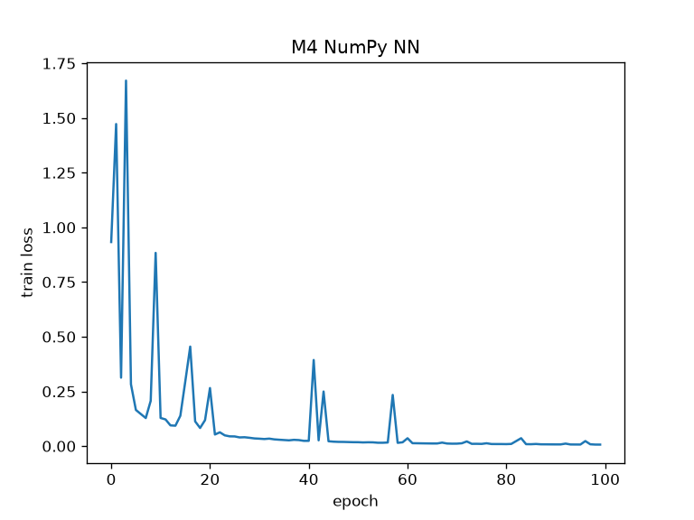
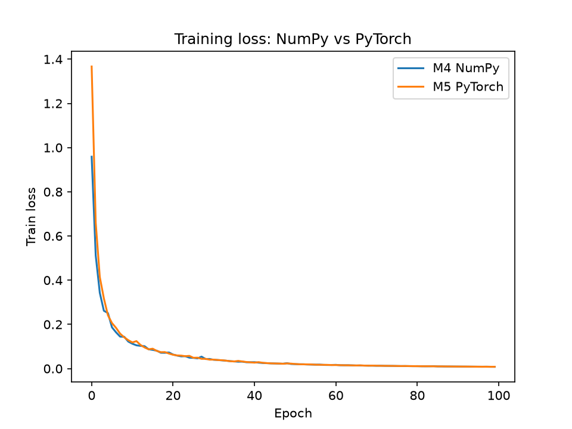

## M1: Linear regression from scratch
Folder `m1_linear_regression/`: NumPy gradient descent compared with scikit-learn on the Diabetes dataset (test MSE 2889.93 vs 2900.19).

Run: `cd m1_linear_regression && python -m pytest && python -m src.compare`

# Deep Learning Lab: Digits Classifier, NumPy vs PyTorch

The same neural network built twice on the sklearn digits dataset (8x8 handwritten digits, 10 classes): once from scratch in NumPy with hand-written backpropagation, once in PyTorch with autograd. Both are compared on identical data.

## Structure
```
m4_m5_digits/
  nn_numpy.py              M4: NumPy network, backprop, gradient check
  torch_classifier.py      M5: PyTorch model, training loop, checkpoint
  compare_m4_m5.py         trains both and writes the comparison
  test_nn.py               tests for M4
  test_torch_classifier.py tests for M5
```

## Run
    pip install -r requirements.txt
    cd m4_m5_digits
    pytest -q
    python compare_m4_m5.py

## M4: NumPy from scratch
Network: 64 inputs, 32 tanh hidden units, 10 softmax outputs, cross-entropy loss, mini-batch SGD (lr 0.5, batch 64, 100 epochs).

Hand-written backprop matches numerical gradients (finite differences) to a relative error of 1.38e-10.

Standalone result, original 75/25 split with no validation set: test accuracy 97.56%, macro-F1 97.55%. Do not compare this number with the table below, since the split differs.



## M5: PyTorch with a fair comparison
Same architecture, optimizer, learning rate, batch size and epochs. Both models use one shared 60/20/20 train/validation/test split. The PyTorch version uses an explicit training and validation loop (no Trainer) and a saved and reloaded checkpoint.

| Model | Val accuracy | Test accuracy | Test macro-F1 |
|---|---|---|---|
| M4 NumPy | 0.9666 | 0.9583 | 0.9581 |
| M5 PyTorch | 0.9638 | 0.9750 | 0.9752 |

Reloading the saved checkpoint gives identical predictions.

The test gap is about 6 images out of 360, and the validation ranking is reversed. With one split and one seed, the two models are equivalent within noise.



## Limitations
- Small 8x8 dataset, one split, one seed.
- Hyperparameters were set by hand, not tuned.
- No regularization or data augmentation.

## Stack
Python, NumPy, PyTorch (CPU), scikit-learn, pandas, Matplotlib, pytest, Git/GitHub