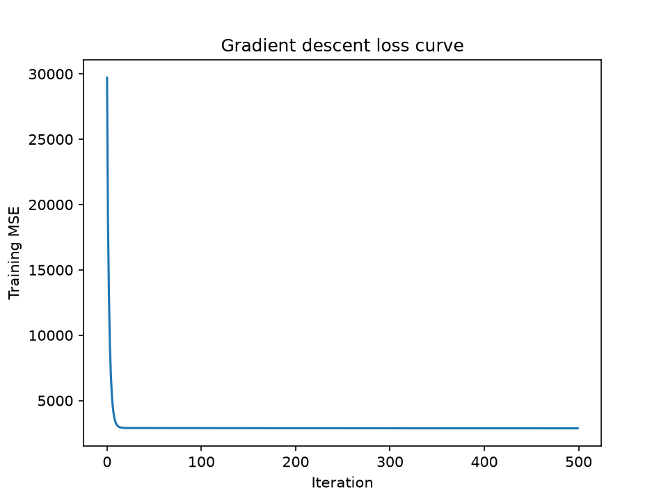

# ML Foundations

Hands-on machine learning built from scratch, then compared with standard libraries.

## Structure
```
m1_linear_regression/   M1: NumPy linear regression vs scikit-learn
m4_m5_digits/           M4 + M5: neural network in NumPy vs PyTorch
```

## M1: Linear regression from scratch
NumPy gradient descent compared with scikit-learn on the Diabetes dataset.

| Model | Test MSE |
|---|---|
| This implementation (lr=0.1, 500 iterations) | 2889.93 |
| scikit-learn LinearRegression | 2900.19 |

The two models are effectively equivalent. Single dataset, single split.

Run: `cd m1_linear_regression && python -m pytest && python -m src.compare`



## M4: Neural network from scratch (NumPy)
Network: 64 inputs, 32 tanh hidden units, 10 softmax outputs, cross-entropy loss, mini-batch SGD (lr 0.5, batch 64, 100 epochs).

Hand-written backprop matches numerical gradients to a relative error of 1.38e-10.

Standalone result, original 75/25 split, no validation set: test accuracy 97.56%, macro-F1 97.55%. Do not compare this with the M5 table below, since the split differs.


## M5: PyTorch with a fair comparison
Same architecture, optimizer, learning rate, batch size and epochs. Both models use one shared 60/20/20 split. The PyTorch version has an explicit training and validation loop and a saved and reloaded checkpoint.

| Model | Val accuracy | Test accuracy | Test macro-F1 |
|---|---|---|---|
| M4 NumPy | 0.9666 | 0.9583 | 0.9581 |
| M5 PyTorch | 0.9638 | 0.9750 | 0.9752 |

Reloading the checkpoint gives identical predictions. The test gap is about 6 images out of 360 and the validation ranking is reversed, so the two models are equivalent within noise.


## Run
    pip install -r requirements.txt
    cd m4_m5_digits
    pytest -q
    python compare_m4_m5.py

## Limitations
- Small datasets, one split, one seed.
- Hyperparameters set by hand, not tuned.
- No regularization or data augmentation.

## Stack
Python, NumPy, PyTorch (CPU), scikit-learn, pandas, Matplotlib, pytest, Git/GitHub